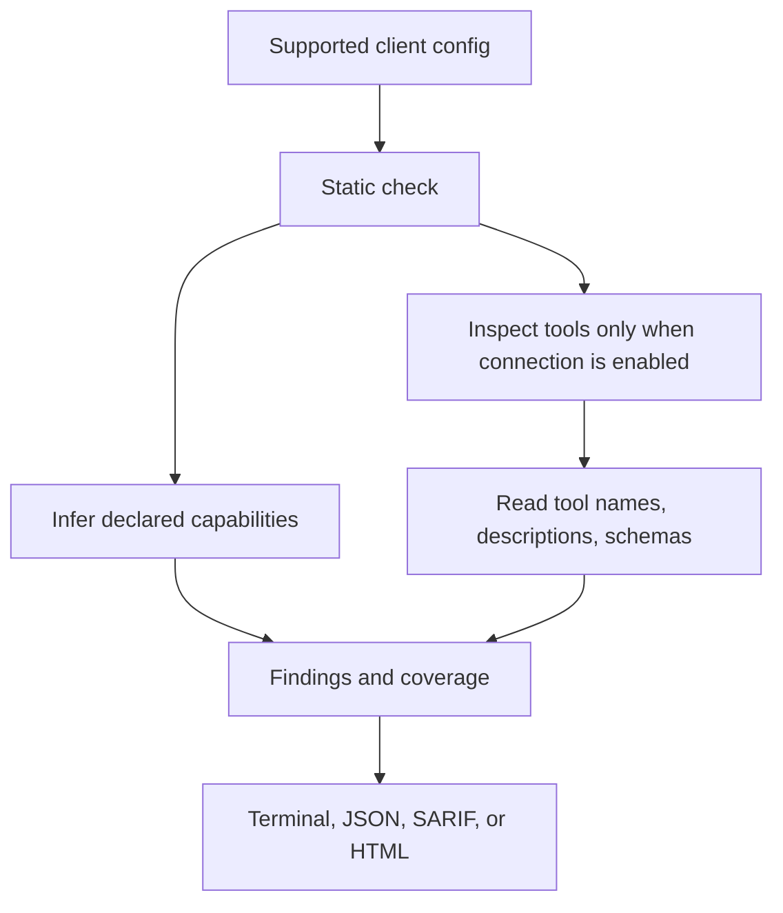

# How MCPAudit works

MCPAudit has separate static review and connected inspection paths. The command
you choose determines whether configured MCP servers are started or contacted.

## Static check

`mcp-audit` runs `check`. It reads supported configuration candidates and
infers possible capabilities from declared commands, arguments, environment
variable key names, and endpoints. Use `--config FILE` to select one explicit
file; that excludes discovery unless `--include-discovered` is requested.
`inspect` lists discovered identities and source status without connecting.

`demo` uses the bundled synthetic sandbox configuration and does not perform
workstation discovery. The static pass does not start MCP servers. It can show
only what the configuration and available static evidence support.

## Connected inspection

`check --connect --server CLIENT:SCOPE:NAME` requires one unambiguous identity.
It may start a local process or contact a configured endpoint to list server
capabilities. `check --connect-all` connects to the reviewed fleet and conflicts
with `--connect` and `--server`. Project servers remain skipped unless
`--connect-project-configs` is supplied. `--config FILE` limits the sources to
that file unless `--include-discovered` is requested. `--max-concurrency` bounds
simultaneous sessions; `--timeout` applies per session and excludes queue wait.
Fleet canary requires an explicit file without discovery.
Legacy `scan` no longer has separate behavior: it refuses forms that would
connect or silently lose coverage with exit 2 before discovery, and runs other
forms through `check` (see the [CLI reference](cli.md#legacy-scan-interceptor)). Starting
a server is not the same as calling its tools; the opt-in canary is a distinct
operation that may make bounded empty-argument calls when eligible.

Package verification and artifact downloads contact registries only when their
specific options are requested. LLM analysis is also opt-in. Review command
help and the relevant guides before enabling these operations.

## Outputs and limits

The report combines findings with coverage information, including checks that
were skipped or incomplete. JSON fields and SARIF identifiers are described in
the [output contract](OUTPUT-CONTRACT.md). Findings are heuristics or bounded
observations, not proof that a server is benign or malicious. A clean static
check does not establish runtime behavior.

## Listing size limits

Connected stdio listings reject frames larger than 16 MiB before JSON parsing.
`scan` and `check` accept `--max-frame-bytes` and `--max-surface-bytes` (64 MiB
across listing pages and surfaces). Retained item text is capped at 256 KiB;
`surface_truncated` warns that metadata is incomplete. The temporary
`--sdk-stdio-fallback` flag uses the SDK reader for compatibility and disables
the frame cap; it retains the listing caps. See the [output contract](OUTPUT-CONTRACT.md).

## Large fleets

When run from `mcp-audit check --connect-all` on POSIX hosts supporting spawn and
process-group cleanup, connected scans of fleets larger than 256 servers run their per-server connection, enumeration and analysis stages
in `min(cpu_count or 1, ceil(server_count / 256), 8)` worker processes, provided
that gives at least two workers. Slices are contiguous; audits return in input
order. Each worker uses `max(1, ceil(max_concurrency / workers))` local slots;
parent-owned connection tokens also enforce the exact scan-wide connection
limit when rounding would otherwise oversubscribe it. Discovery, setup and
baseline decisions, fleet trifecta/shadowing checks, scoring finalization,
redaction and report construction stay in the parent.

Pin creation/refresh, canary, LLM analysis, pin comparison and any pin-baseline checks (escalation,
provenance, integrity, package/artifact verification), caller-supplied pin stores
and custom override appliers silently retain the single-process path. Pin
verification can update rollback tracking, and package verifiers share a
scan-wide registry cache; these modes do not have a separate read-only worker
baseline protocol. Unsupported hosts and single-core hosts also retain that path.
`--skip-connect` scans never shard (they spawn no process), and library
callers of `run_scan` and the `mcp_audit.api` entry points stay single-process.
There is no public sharding option.

Workers capture stderr and reap their own MCP process groups. The parent tracks
registered groups, reaps workers, and cleans up registered groups after a crash
or cancellation. A missing worker result is a failed audit with a
`worker_process_failed` warning; completed results from that worker and its
siblings remain available. Report warning sorting and the JSON schema remain
unchanged.
